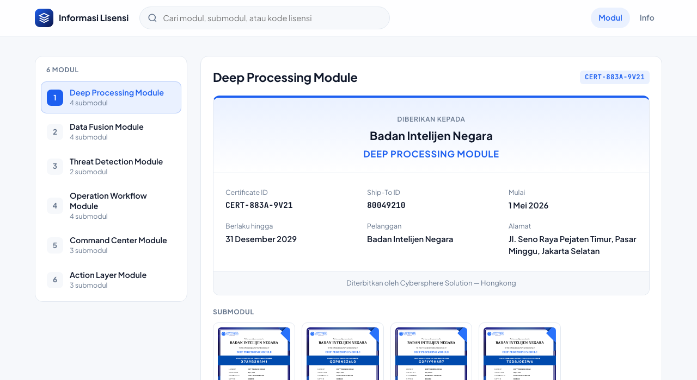
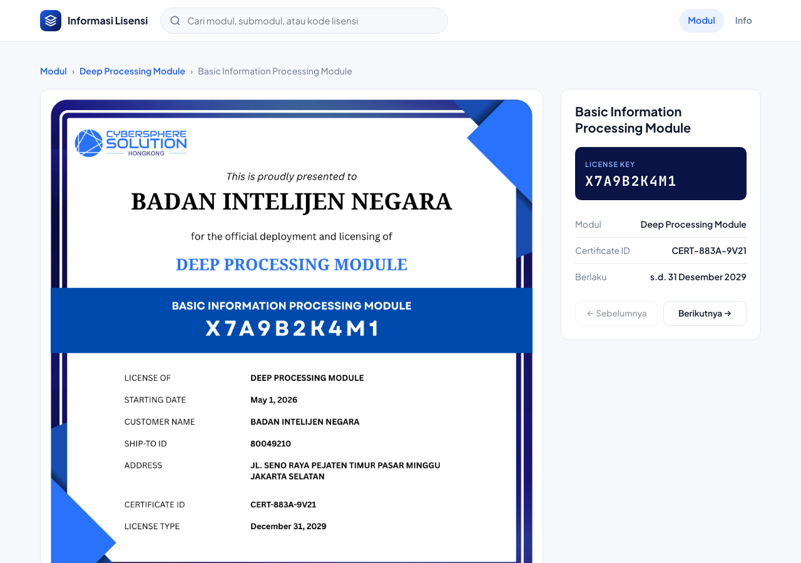

# Portal Informasi Lisensi — Badan Intelijen Negara

Website informasi detail lisensi **6 Modul** dan **20 Submodul** resmi **Cybersphere Solution — Hongkong** untuk **Badan Intelijen Negara** (Masa berlaku: **1 Mei 2026 – 31 Desember 2029**).

🌐 **Live Web UI (GitHub Pages):** [**https://fulmal.github.io/cek_license/**](https://fulmal.github.io/cek_license/)

---

## Tampilan Antarmuka (UI)

### 1. Halaman Modul (Tab 6 Modul & Informasi Sertifikat 3 Kolom)

### 2. Halaman Detail Sertifikat Submodul

